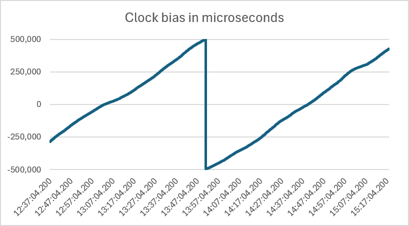

## Navigation Epochs

### Background

It has been observed that SBP and GPY files from the ESP-GPS can contain unexpected timestamp intervals.

e.g. 5 Hz files have intervals of 200 ms, but 199 ms and 201 ms are sometimes evident in GPY and SBP files.

One example from a GPY file:

```
File: M10_LISA_K888_2605131437.gpy

Observed time distribution (in ms): 
199 1
200 48274
201 1

Points with untypical dt (and speed > 5.0 knots):
1  201 ms at #22167 13:50:57.601 speed: 20.821 sAcc: 0.138
2  199 ms at #22170 13:50:58.200 speed: 22.010 sAcc: 0.344
```

The corresponding UBX file does not exhibit these issues:

```
File: M10_LISA_K888_2605131437.ubx

Observed time distribution (in ms): 
200 48276

0 time errors (0 above 5.0 knots), about 0 missing points
```

This document discusses the cause of these anomalies, and presents a recommendation for the ESP-GPS.


### Why It Happens

The primary cause of the issue is the difference between what the GNSS chip is trying to do, and what it is actually doing.

- The desired navigation solution time; e.g. exact multiple of 200 ms
- The actual navigation solution time; i.e. ±0.5 ms or  ±500000 nanoseconds
- The reported navigation solution time; year, month, day, hour, minute, second, nano

Key points:

 - Internal 1 kHz clock is used to schedule each navigation solution - e.g. 200 ticks = 200 ms
   - The TCXO which drives the 1 kHz clock will typically have an accuracy between 0.1 to 1.0 ppm

  - UBX-NAV-PVT includes the UTC time of the navigation solution with nanosecond precision
    - The values of nano can range from -5 ms to 995 ms, and must be applied to the UTC


The clock bias, clock drift and time accuracy can be observed via `UBX-NAV-CLOCK`. The integration period in the u-blox receiver is some millisecond multiple, so when sufficient bias accumulates the clock is slewed such that the next measurement / correlation period has one more, or less, millisecond so as to get the "measurement" time closer to being "on target" or "top-of-second".

When the UTC values are analysed they can be seen to be within ±0.5 ms of the intended offset (e.g. multiple of 200 ms for 5 Hz). The example M10_LISA_K888_2605131437 contains a median interval of 200.000036 ms, and the timing of navigation solutions can be seen to drift over time. During the middle of the session the bias is slewed from +0.5 ms to -0.5 ms, thus keeping navigation solutions within ±0.5 ms of the intended times.




This is why GPS Speedreader reported the unexpected time intervals of 199 ms and 201 ms:

```
File: M10_LISA_K888_2605131437.gpy

Observed time distribution (in ms): 
199 1
200 48274
201 1

Points with untypical dt (and speed > 5.0 knots):
1  201 ms at #22167 13:50:57.601 speed: 20.821 sAcc: 0.138
2  199 ms at #22170 13:50:58.200 speed: 22.010 sAcc: 0.344
```

The "apparent" 201 ms interval occurred first, exactly when the clock bias exceeded 0.5 ms. After the following top-of-the-second epoch, the next navigation solution was scheduled using a 199 ms interval. There was never an interval of 201 ms, but the 199 ms interval was genuine.


### Top-of-the-Second Epoch

Excessive clock drift is always resolved immediately after the top-of-the-second epoch; e.g. between 13:50:58.001 and 13:50:58.200:

| Nano | Time | Diff (s) |
| --------: | :----------: | :---: |
| 400499983 | 13:50:57.400 | 0.200 |
| 600500011 | 13:50:57.601 | 0.201 |
| 800500040 | 13:50:57.801 | 0.200 |
| 500068    | 13:50:58.001 | 0.200 |
| 199500097 | 13:50:58.200 | 0.199 |
| 399500126 | 13:50:58.400 | 0.200 |

The clock drift misleadingly looks like a 201 ms interval, but the subsequent correction really is a 199 ms interval. In reality the 201 ms interval was never any different from the intervals beforehand... which had a median of 200.000036 ms throughout the session. The subsequent correction used a 199 ms interval, but that is just how u-blox ensures that subsequent navigation solutions are close to the intended timings, typically ±0.5 ms.

Warning: Clock drift can result in dropped frames shortly after the top-of-the-second epoch, because the adjustment reduces the time for the navigation solution - e.g. between 13:50:58.001 and 13:50:58.200. This will typically be an issue if too many satellites are being used, or the log rate is too high. The number of satellites and the update rate may be fine for most of a session, but there may be too little time when the clock is corrected.


### Consequences

There are a number of consequences of clock drift and the periodic adjustments:

- SBN and GPY may seemingly contain anomalies, due to reduced millisecond precision
  - UBX files will generally be fine because the original nanosecond precision can be used
- Some of the unexpected intervals in GPY and SBN files are completely erroneous
  - There are no 201 ms intervals in the data, just artefacts of millisecond precision
- It gives the appearance that some records have timestamps that are wrong by 1 ms
  - Timestamps are typically ±0.5 ms, and the few outliers differ by mere nanoseconds
- Comparisons of files from two devices (or combining the two) is more complicated
  - The millisecond timestamps may be different, despite being mere nanoseconds apart


### Recommendation

It should be noted that u-blox themselves round UTC to the nearest hundredth of a second for NMEA.

Divisors of 1000 provide the most useful logging rates, and they all have intervals that are divisible by 5 ms.

| Rate (Hz) | Interval (ms) |
| :-------: | :-----------: |
|     1     |     1000      |
|     2     |      500      |
|     4     |      250      |
|     5     |      200      |
|     8     |      125      |
|    10     |      100      |
|    20     |      50       |
|    25     |      40       |

Thus the simplest fix is to change the rounding that is present in `gpy.h` and `sbp.h`.

Current code:

```c
int64_t utc_ms= utc_Sec*1000LL+(ubxMessage.navPvt.nano+500000)/1000000LL;

sbp_frame.UtcSec=ubxMessage.navPvt.second*1000+(ubxMessage.navPvt.nano+500000)/1000000;
```

Recommended code:

```c
int64_t utc_ms= utc_Sec*1000LL+(ubxMessage.navPvt.nano+2500000LL)/5000000LL*5;

sbp_frame.UtcSec=ubxMessage.navPvt.second*1000+(ubxMessage.navPvt.nano+2500000LL)/5000000LL*5;
```

The recommended code uses the exact same trick for integer rounding in C, but rounding to the nearest 5 ms.


### Benefits

This two line change provides a number of benefits:

  - Consistency between GPY, SPB, and UBX
    - Files from the same session can be processed consistently
  - Consistency with u-blox and the Motion GPS
    - The Motion GPS already implements this logic for 1, 2, 5, 10 Hz
  - Cleaner data and avoiding the potential for confusion
    - Standard intervals also makes missing points more obvious
  - Simplified comparisons and averaging between multiple devices
    - This is particularly useful for multi-device calculations


### Considerations

Timestamps are ±0.5 ms and have a mean absolute error (MAE) of 0.25 ms. Timestamps such as 0.201, 0.401, 0.601 have drifted by <0.1 μs, which is 3 or 4 orders of magnitude smaller than the MAE of 0.25 ms. Rounding these timestamps to the intended values is arguably more representative than leaving them unchanged. They are in principle no different to the thousands of timestamps that preceded them in the file.

The proposed fix works well for all of the common logging rates, which have intervals that are divisible by 5 ms. The one exception on the ESP-GPS is 15 Hz, but that is rather an unusual rate. Setting `CFG-RATE-MEAS` to 67 ms will take 67 seconds for the sequence of timestamps to repeat, and applying a suitable rounding fix is not quite so straightforward. My suggestion would be to just remove 15 Hz from the ESP-GPS.


### GPS Speedreader

It should be noted that there is an issue with the way that GPS Speedreader currently handles UBX timestamps:

- 8 Hz issue = 124 ms (25%), 125 ms (50%), 126 ms (25%)... but correct in GPSResults (125 ms)
  - e.g. C:\Users\mwgeo\OneDrive\Documents\GPS Files\Windsurfing\2026\La Nautique, Narbonne\2026-05-03
- 15 Hz issue = alternates between 66 ms (50%) and 68 ms (50%)... but correct in GPSResults (67 ms)
  - C:\Users\mwgeo\OneDrive\Projects\GPS\Logs\Organised\ESP-GPS\Salvador, SYRAC-GPS\2026-04-26, SYRAC-GPS, 15 Hz\
  

This issue is unique to GPS Speedreader, but would also be worth fixing.


### Wrap Up

The proposed two line change will resolve the timestamp issues in GPY and SBP files from the ESP-GPS.

This will make them consistent with the Motion GPS, and also the NMEA sentences produced by the u-blox chip itself.


### Further Information

#### iTOW

Quote from [MAX M10S Integration Manual](https://content.u-blox.com/sites/default/files/MAX-M10S_IntegrationManual_UBX-20053088.pdf) - 3.7.4 iTow timestamps:

> The original designers of GPS chose to express time/date as an integer week number (starting with the first full week in January 1980) and a time of week (TOW) expressed in seconds. Manipulating time/date in this form is far easier for digital systems than the more conventional year/month/day, hour/minute/second representation. Therefore, most GNSS receivers use this time representation internally, and convert it to a more conventional form at external interfaces. In many UBX messages, the iTOW field provides an externally visible example of the internal time representation.
>
> All the main UBX-NAV messages (and some other messages) contain an iTOW field to indicate the GPS time when the navigation epoch occurred. Messages with the same iTOW value can be assumed to have come from the same navigation solution, and therefore, iTOW can be used to synchronize between these UBX messages. However, the iTOW values may not be valid (i.e., they may have been generated with insufficient conversion data). Therefore, it is not recommended to use the iTOW field for any other purpose.
>
> If reliable absolute time information is required, use the UTC time related fields in the UBX-NAV-PVT message. Additionally, the UBX-NAV-PVT message contains information about the validity and the accuracy of the provided UTC time. See the section Time validity for further information.
>
> - iTOW is always referenced to GPS time, and it should not be confused with the UTC representation.
>
> - The iTOW timestamps are not compensated for the Leap seconds.

Additional notes:

- iTOW wraps around every Sunday at 00:00:00, which is 10:00 or 11:00 in Victoria, Australia
- iTOW is 18 seconds ahead of the UTC representation, which does compensate for leap seconds.
- The last leap second was on 31 Dec 2016, but there are no plans for further leap seconds.
- The ESP-GPS used to subtract 18 seconds from iTOW, due to an issue in GPSResults.


#### UTC Representation

Quote from [MAX M10S Integration Manual](https://content.u-blox.com/sites/default/files/MAX-M10S_IntegrationManual_UBX-20053088.pdf) - 3.7.6 UTC representation:

> UTC time is used in many NMEA and UBX messages. In NMEA messages, time is always rounded to the nearest hundredth of a second and it is normally reported with two decimal places (e.g. 124923.52). Although compatibility mode (selected using CFG-NMEA-COMPAT) requires three decimal places, rounding to the nearest hundredth of a second remains, so the extra digit is always 0.
>
> UTC time is also reported within some UBX messages, such as UBX-NAV-TIMEUTC and UBX-NAVPVT. In these messages date and time are separated into seven distinct integer fields. Six of these (year, month, day, hour, min. and sec.) have fairly obvious meanings and are all guaranteed to match the corresponding values in NMEA messages generated by the same navigation epoch. This facilitates simple synchronization between associated UBX and NMEA messages.
>
> The seventh field is called nano and it contains the number of nanoseconds by which the rest of the time and date fields need to be corrected to get the precise time. So, for example, the UTC time 12:49:23.521 would be reported as: hour: 12, min: 49, sec: 23, nano: 521000000.
>
> It is however important to note that the first six fields are the result of rounding to the nearest hundredth of a second. Consequently the nano value can range from -5000000 (i.e. -5 ms) to +994999999 (i.e. nearly 995 ms).
>
> When the nano field is negative, the number of seconds (and maybe minutes, hours, days, months or even years) have been rounded up. Therefore, some or all of them must be adjusted to get the correct time and date. Thus in an extreme example, the UTC time 23:59:59.9993 on 31st December 2011 would be reported as: year: 2012, month: 1, day: 1, hour: 0, min: 0, sec: 0, nano: -700000.
>
> If a resolution of one hundredth of a second is adequate, negative nano values can simply be rounded up to 0 and effectively ignored.


#### Typical Intervals

Some example intervals between UTC timestamps:

-  5 Hz M10 (LISA) = 200.000011 ms
-  8 Hz M10 (LISA) = 125.000035 ms
- 20 Hz M9 (Manfred) = 50.000008 ms


### References

u-blox documentation:

- [MAX M10S Integration Manual](https://content.u-blox.com/sites/default/files/MAX-M10S_IntegrationManual_UBX-20053088.pdf) - see 3.7.3 Navigation epochs

u-blox forums:

- [The ublox M8t claim to have been synchronised with GPS, but why i get fractional-seconds time stamp](https://portal.u-blox.com/s/question/0D52p00008HKDVrCAP/the-ublox-m8t-claim-to-have-been-synchronised-with-gps-but-why-i-get-fractionalseconds-time-stamp) - 30 Jan 2018
- [How to configure message timestamp of ZED-F9P to output a full second when 10Hz measurement frequency is set](https://portal.u-blox.com/s/question/0D52p0000BlW3MjCQK/how-to-configure-message-timestamp-of-zedf9p-to-output-a-full-second-when-10hz-measurement-frequency-is-set) - 1 Dec 2021
- [Clarification on UTC representation as it relates to PPS. How closely is PPS synchronized to UTC time?](https://portal.u-blox.com/s/question/0D5Oj000006ORtVKAW/clarification-on-utc-representation-as-it-relates-to-pps-how-closely-is-pps-synchronized-to-utc-time) - 16 Feb 2024


### Notes to Self

Example session:

- C:\Users\mwgeo\OneDrive\Documents\GPS Files\Windsurfing\2026\Gruissan\2026-05-13
